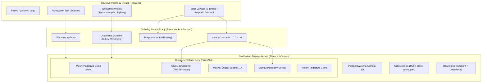

# Specyfikacja Techniczna i Funkcjonalna: Wizualizator Siatek Graniastosłupów Prostych 3D

> **Projekt:** Interaktywna aplikacja webowa do animacji składania i rozkładania siatek graniastosłupów prostych  
> **Wersja dokumentu:** 1.0.0  
> **Data:** 22 listopada 2026 r.  
> **Status:** Zatwierdzona do wdrożenia  
> **System docelowy:** Nowoczesne przeglądarki internetowe (Google Chrome, Microsoft Edge, Firefox) na systemie Windows 11 oraz platformach mobilnych/desktopowych

---

## Spis treści
1. [Wprowadzenie i Cel Projektu](#1-wprowadzenie-i-cel-projektu)
2. [Wymagania Funkcjonalne](#2-wymagania-funkcjonalne)
3. [Obsługiwane Bryły Geometryczne](#3-obsługiwane-bryły-geometryczne)
4. [Model Matematyczny i Kinematyka Składania Siatek](#4-model-matematyczny-i-kinematyka-składania-siatek)
5. [Wybór Stosu Technologicznego](#5-wybór-stosu-technologicznego)
6. [Architektura Aplikacji i Struktura Kodu](#6-architektura-aplikacji-i-struktura-kodu)
7. [Projekt Interfejsu Użytkownika (UI/UX)](#7-projekt-interfejsu-użytkownika-uiux)
8. [Wymagania Niefunkcjonalne](#8-wymagania-niefunkcjonalne)
9. [Kompletna Instrukcja Uruchomienia (Windows 11)](#9-kompletna-instrukcja-uruchomienia-windows-11)
10. [Plan Testów i Weryfikacji](#10-plan-testów-i-weryfikacji)
11. [Możliwości Rozbudowy w Przyszłości](#11-możliwości-rozbudowy-w-przyszłości)

---

## 1. Wprowadzenie i Cel Projektu

Aplikacja jest interaktywnym, edukacyjnym narzędziem internetowym renderującym trójwymiarową scenę w czasie rzeczywistym. Jej głównym celem jest pomoc uczniom, nauczycielom oraz pasjonatom geometrii w zrozumieniu przejścia pomiędzy dwuwymiarową siatką wielościanu (płaszczyzna 2D) a gotową bryłą trójwymiarową (3D).

Użytkownik ma możliwość płynnego sterowania procesem składania bryły za pomocą suwaka, swobodnego manipulowania kamerą (obrót, zbliżanie, przesuwanie) oraz przełączania się pomiędzy różnymi rodzajami graniastosłupów prostych.

---

## 2. Wymagania Funkcjonalne

### 2.1. Wybór bryły (Prism Selector)
- Rozwijana lista (dropdown) lub kafelki wyboru umożliwiające natychmiastowe przełączenie aktywnego graniastosłupa.
- Obsługa czterech wymaganych typów brył:
  1. **Graniastosłup prawidłowy trójkątny** (podstawa: trójkąt równoboczny, 3 ściany boczne)
  2. **Graniastosłup prawidłowy czworokątny** (podstawa: kwadrat, 4 ściany boczne / prostopadłościan foremny)
  3. **Graniastosłup prawidłowy pięciokątny** (podstawa: pięciokąt foremny, 5 ścian bocznych)
  4. **Graniastosłup prawidłowy sześciokątny** (podstawa: sześciokąt foremny, 6 ścian bocznych)
- Przy zmianie bryły następuje płynne zresetowanie lub zachowanie aktualnego kąta złożenia (konfigurowalne w opcjach).

### 2.2. Regulacja stopnia złożenia (Fold Controller)
- **Suwak poziomy (Slider):**
  - Zakres wartości: od `0%` (siatka całkowicie płaska – 2D) do `100%` (bryła całkowicie złożona – 3D).
  - Krok suwaka: `0.1%` lub płynna interpolacja zmiennoprzecinkowa (wartość $t \in [0.0, 1.0]$).
  - Wskaźnik numeryczny pokazujący dokładny stopień złożenia w procentach i/lub kątach obrotu ścian.
- **Dodatkowe opcje sterowania animacją:**
  - Przycisk `Odtwórz / Wstrzymaj (Play / Pause)` uruchamiający automatyczną animację zapętloną w przód i w tył (ping-pong: $0\% \to 100\% \to 0\%$).
  - Regulacja prędkości animacji (np. `0.5x`, `1.0x`, `2.0x`).
  - Przyciski szybkiego skoku: `Rozłóż (0%)` oraz `Złóż (100%)`.

### 2.3. Interaktywny widok 3D (Viewport & OrbitControls)
- **Rotacja sceny:** Lewy przycisk myszy (LPM) + przeciąganie w dowolnym kierunku (pełne 360° wokół osi X, Y, Z).
- **Przybliżanie / oddalanie (Zoom):** Rolka myszy (kółko scrolla) lub gest uszczypnięcia (pinch-to-zoom) na ekranach dotykowych.
- **Przesuwanie kamery (Pan):** Prawy przycisk myszy (PPM) lub LPM z wciśniętym klawiszem `Shift`.
- **Przycisk zerowania kamery (Reset Camera View):** Przywraca domyślny kąt izometryczny oraz optymalny dystans od bryły.

### 2.4. Personalizacja i pomoce wizualne
- Przełącznik podświetlania krawędzi (wireframe / edge highlighting).
- Kolorystyczne rozróżnienie podstaw (np. odcień błękitu/morska zieleń) i ścian bocznych (odcienie pomarańczu/żółci).
- Dwustronne renderowanie ścian (`side: THREE.DoubleSide`), zapobiegające znikaniu powierzchni od wewnętrznej strony.
- Opcjonalne etykiety ścian (podstawa dolna, podstawa górna, ściany boczne $1 \dots n$).
- Płynne cieniowanie i oświetlenie ambientowe + kierunkowe (DirectionalLight) dające realistyczne poczucie głębi.

---

## 3. Obsługiwane Bryły Geometryczne

Poniższa tabela przedstawia parametry topologiczne każdej z implementowanych brył:

| Nazwa bryły | Liczba wierzchołków ($V$) | Liczba krawędzi ($E$) | Liczba ścian ($F$) | Ściany boczne | Kształt podstawy |
| :--- | :---: | :---: | :---: | :---: | :---: |
| **Graniastosłup trójkątny** | 6 | 9 | 5 (2 podstawy + 3 boczne) | 3 prostokąty | Trójkąt równoboczny |
| **Graniastosłup czworokątny** | 8 | 12 | 6 (2 podstawy + 4 boczne) | 4 prostokąty | Kwadrat |
| **Graniastosłup pięciokątny** | 10 | 15 | 7 (2 podstawy + 5 bocznych) | 5 prostokątów | Pięciokąt foremny |
| **Graniastosłup sześciokątny** | 12 | 18 | 8 (2 podstawy + 6 bocznych) | 6 prostokątów | Sześciokąt foremny |

Dla każdego $n$-kątnego graniastosłupa prostego zachodzi zależność Eulera:
$$V - E + F = 2n - 3n + (n + 2) = 2$$

---

## 4. Model Matematyczny i Kinematyka Składania Siatek

### 4.1. Topologia siatki (Typ: Siatka Gwiaździsta z Pokrywą)
Najbardziej czytelnym i naturalnym dla uczniów modelem siatki graniastosłupa prostego jest **układ gwiaździsty z jedną ścianą nośną podstawy górnej**:
1. **Podstawa dolna (Root Base):** Spoczywa na płaszczyźnie poziomej $XZ$ (kotwica układu współrzędnych, brak rotacji).
2. **Ściany boczne (Lateral Faces $1 \dots n$):** Połączone zawiasowo bezpośrednio z każdą z $n$ krawędzi podstawy dolnej.
3. **Podstawa górna (Top Base):** Połączona zawiasowo z górną krawędzią wybranej ściany bocznej (np. ściany nr 1).

```
                      [ Podstawa górna ]
                              |  (oś obrotu górna)
                      [ Ściana boczna 1 ]
                              |  (oś obrotu boczna)
[Ściana boczna 4] --- [ PODSTAWA DOLNA  ] --- [Ściana boczna 2]
                              |  (oś obrotu boczna)
                      [ Ściana boczna 3 ]
```
*(Schemat poglądowy dla graniastosłupa czworokątnego w stanie $t=0$)*

### 4.2. Kinematyka składania (Hierarchia Sceny 3D)

Niech $t \in [0.0, 1.0]$ oznacza stopień złożenia:
- **$t = 0.0$:** Siatka w pełni rozłożona (wszystkie wielokąty leżą płasko na płaszczyźnie $Y = 0$).
- **$t = 1.0$:** Bryła w pełni zamknięta w przestrzeni 3D.

#### Kąty obrotu ścian:
1. **Ściany boczne ($k = 1 \dots n$):**
   - Kąt obrotu wokół krawędzi podstawy:
     $$\theta_{\text{boczna}}(t) = t \cdot 90^\circ = t \cdot \frac{\pi}{2} \text{ rad}$$
   - Obrót następuje wokół osi lokalnej leżącej wzdłuż krawędzi podstawy dolnej, unosząc ścianę do pionu pod kątem $90^\circ$ względem podstawy.

2. **Podstawa górna:**
   - Podstawa górna jest dzieckiem (child node w drzewie sceny Three.js) ściany bocznej nr 1.
   - Gdy ściana boczna unosi się o kąt $\theta_{\text{boczna}}(t)$, podstawa górna jest unoszona wraz z nią.
   - Dodatkowo, podstawa górna obraca się wokół osi zawiasu łączącego ją ze ścianą boczną o kąt:
     $$\theta_{\text{górna}}(t) = t \cdot 90^\circ = t \cdot \frac{\pi}{2} \text{ rad}$$
   - W stanie $t = 1.0$ ściana boczna jest nachylona o $90^\circ$, a podstawa górna zagina się o kolejne $90^\circ$ do wewnątrz, stając się idealnie równoległa do podstawy dolnej na wysokości $H$ bryły.

---

## 5. Wybór Stosu Technologicznego

W celu zapewnienia natychmiastowego czasu ładowania, responsywności 60+ FPS, łatwości uruchomienia oraz braku konieczności instalowania zewnętrznych baz danych czy skomplikowanych serwerów backendowych, wybrano nowoczesny i sprawdzony stos webowy:

| Warstwa | Technologia | Wersja | Uzasadnienie wyboru |
| :--- | :--- | :--- | :--- |
| **Środowisko uruchomieniowe** | Node.js (LTS) | $\ge 20.x$ | Standard de facto dla nowoczesnego developmentu front-endowego, wbudowany menedżer pakietów npm. |
| **Narzędzie budujące (Bundler)** | Vite | $\ge 5.x$ / $6.x$ | Błyskawiczny start serwera deweloperskiego (HMR w ułamku sekundy), zoptymalizowany build produkcyjny rollup. |
| **Biblioteka UI** | React | 18 / 19 | Deklaratywne zarządzanie stanem (suwak, wybór bryły, stan animacji), bogaty ekosystem komponentów. |
| **Język programowania** | TypeScript | $\ge 5.x$ | Ścisłe typowanie modeli matematycznych, wektorów 3D, geometrii i interfejsów parametrów. |
| **Silnik graficzny 3D** | Three.js | $\ge 0.160+$ | Wiodący silnik WebGL/WebGPU w przeglądarkach, doskonała wydajność, dojrzały moduł OrbitControls. |
| **Integracja 3D w React** | @react-three/fiber & @react-three/drei | Najnowsza | Deklaratywny zapis sceny 3D jako komponentów React, automatyczne czyszczenie zasobów WebGL. |
| **Stylizacja UI** | Tailwind CSS | $\ge 3.4$ | Błyskawiczne tworzenie nowoczesnego, czystego i responsywnego interfejsu (glassmorphism, clean controls). |
| **Ikony UI** | Lucide React | Najnowsza | Lekkie, wektorowe ikony odtwarzania, pauzy, resetu widoku i ustawień. |

---

## 6. Architektura Aplikacji i Struktura Kodu

### 6.1. Diagram Architektury



### 6.2. Drzewo Katalogów Projektu

```text
graniastoslupy/
├── index.html
├── package.json
├── tsconfig.json
├── vite.config.ts
├── tailwind.config.js
├── postcss.config.js
├── SPECYFIKACJA.md
└── src/
    ├── main.tsx                   # Punkt wejścia aplikacji React
    ├── App.tsx                    # Główny kontener aplikacji
    ├── types/
    │   └── prism.ts               # Definicje typów TypeScript
    ├── math/
    │   ├── geometry.ts            # Wyliczanie wierzchołków n-kątów foremnych
    │   └── prismConfigs.ts        # Parametry geometryczne dla n=3, 4, 5, 6
    ├── components/
    │   ├── UI/
    │   │   ├── Header.tsx         # Nagłówek aplikacji
    │   │   ├── PrismSelector.tsx  # Przyciski wyboru bryły
    │   │   ├── FoldSlider.tsx     # Suwak z kontrolkami odtwarzania
    │   │   └── ViewSettings.tsx   # Przełączniki widoku i reset kamery
    │   └── 3D/
    │       ├── SceneContainer.tsx # Canvas R3F + oświetlenie + OrbitControls
    │       ├── PrismNet.tsx       # Główny model składanej siatki
    │       ├── PolygonFace.tsx    # Komponent pojedynczego wielokąta
    │       └── HingeGroup.tsx     # Węzeł obrotu wokół zadanej osi zawiasu
    └── styles/
        └── index.css              # Style Tailwind CSS
```

---

## 7. Projekt Interfejsu Użytkownika (UI/UX)

Układ ekranu został zaprojektowany z myślą o maksymalnej przejrzystości i wygodzie obsługi zarówno na monitorach panoramicznych, jak i ekranach dotykowych:

```
+-------------------------------------------------------------------------+
| [Logo/Tytuł] Wizualizator Siatek Graniastosłupów               [Pomoc ?]|
+-------------------------------------------------------------------------+
|                                  | [Panel Wyboru Bryły]                 |
|                                  |  (o) Trójkątny                       |
|                                  |  ( ) Czworokątny                     |
|                                  |  ( ) Pięciokątny                     |
|                                  |  ( ) Sześciokątny                    |
|                                  |--------------------------------------|
|           OBSZAR 3D              | [Informacje o Bryle]                 |
|                                  | Podstawa: n-kąt foremny              |
|        (Trójwymiarowy model      | Ściany boczne: n prostokątów         |
|         obracany myszką)         | Ściany łącznie: n + 2                |
|                                  |--------------------------------------|
|                                  | [Ustawienia Widoku]                  |
|                                  | [x] Pokaż krawędzie                  |
|                                  | [x] Koloruj podstawy                 |
|                                  | [ Resetuj widok kamery ]             |
+----------------------------------+--------------------------------------+
| [ |< ] [ Play/Pause > ] [ >| ]   ---o----------------- 65% [Złóż / Rozłóż] |
+-------------------------------------------------------------------------+
```

---

## 8. Wymagania Niefunkcjonalne

1. **Wydajność:** Stabilne renderowanie w minimum 60 klatkach na sekundę (FPS) na zintegrowanych kartach graficznych (np. Intel Iris Xe / AMD Radeon Graphics).
2. **Kompatybilność:** Bezproblemowe działanie w przeglądarkach zgodnych z WebGL 2.0 (Google Chrome 90+, Microsoft Edge 90+, Mozilla Firefox 88+, Opera).
3. **Instalacja zerowa u klienta:** Użytkownik końcowy uruchamia aplikację w przeglądarce bez instalowania dodatkowych wtyczek czy pluginów.
4. **Dostępność i Skróty klawiszowe:**
   - `Spacja`: Play / Pause animacji.
   - `Strzałka w lewo` / `Strzałka w prawo`: Zmniejszenie / zwiększenie stopnia złożenia o 1%.
   - `R`: Reset kamery.

---

## 9. Kompletna Instrukcja Uruchomienia (Windows 11)

Poniższa instrukcja krok po kroku przeprowadzi Cię przez proces konfiguracji środowiska i uruchomienia projektu na systemie **Windows 11** przy użyciu **PowerShell**.

### Krok 1: Weryfikacja i instalacja Node.js
Do uruchomienia projektu wymagane jest środowisko Node.js (wersja 20 LTS lub nowsza).

1. Otwórz terminal **PowerShell** w systemie Windows (np. naciskając `Win + X` i wybierając *Terminal* lub *PowerShell*).
2. Sprawdź, czy Node.js jest już zainstalowany:
   ```powershell
   node -v
   npm -v
   ```
3. Jeśli polecenie zwróci błąd lub wersję niższą niż 20.0, zainstaluj oficjalny pakiet Node.js LTS przy pomocy wbudowanego w Windows 11 menedżera pakietów `winget`:
   ```powershell
   winget install OpenJS.NodeJS.LTS
   ```
   *Po instalacji zamknij i otwórz ponownie okno PowerShell, aby odświeżyć zmienne środowiskowe `PATH`.*

---

### Krok 2: Przygotowanie katalogu projektu
Przejdź do wybranego katalogu roboczego:
```powershell
cd c:\Users\Igi\Documents\graniastoslupy
```

---

### Krok 3: Inicjalizacja projektu za pomocą Vite
Utwórz nowy szablon aplikacji React + TypeScript:
```powershell
npm create vite@latest . -- --template react-ts
```
*(Jeśli kreator zapyta o wyczyszczenie bieżącego katalogu lub potwierdzenie instalacji pakietu `create-vite`, wybierz `y` lub Enter).*

---

### Krok 4: Instalacja zależności projektu
Zainstaluj Three.js, biblioteki React Three Fiber, obsługę stylów Tailwind CSS oraz zestaw ikon Lucide:
```powershell
# 1. Główne biblioteki 3D i ikony
npm install three @react-three/fiber @react-three/drei lucide-react clsx tailwind-merge

# 2. Typy deweloperskie TypeScript dla Three.js
npm install -D @types/three

# 3. Konfiguracja Tailwind CSS
npm install -D tailwindcss postcss autoprefixer
npx tailwindcss init -p
```

---

### Krok 5: Konfiguracja Tailwind CSS
W pliku `tailwind.config.js` skonfiguruj ścieżki do szablonów:
```javascript
/** @type {import('tailwindcss').Config} */
export default {
  content: [
    "./index.html",
    "./src/**/*.{js,ts,jsx,tsx}",
  ],
  theme: {
    extend: {},
  },
  plugins: [],
}
```

W pliku `src/index.css` wklej dyrektywy Tailwind:
```css
@tailwind base;
@tailwind components;
@tailwind utilities;

body {
  margin: 0;
  overflow: hidden;
  user-select: none;
}
```

---

### Krok 6: Uruchomienie serwera deweloperskiego
Uruchom lokalny serwer testowy poleceniem:
```powershell
npm run dev
```

Po uruchomieniu w oknie konsoli pojawi się adres lokalny, zazwyczaj:
```text
  VITE v5.x.x  ready in 240 ms

  ➜  Local:   http://localhost:5173/
  ➜  Network: use --host to expose
  ➜  press h + enter to show help
```

Otwórz przeglądarkę **Google Chrome** lub **Microsoft Edge** i przejdź pod adres:
👉 `http://localhost:5173/`

---

### Krok 7: Zbudowanie wersji produkcyjnej (Opcjonalnie)
Gdy aplikacja jest gotowa do udostępnienia w sieci (np. na GitHub Pages, Vercel lub Netlify):
```powershell
npm run build
```
Gotowy, zminifikowany kod HTML/JS/CSS znajdzie się w katalogu `dist/`. Możesz go przetestować lokalnie poleceniem:
```powershell
npm run preview
```

---

### Rozwiązywanie częstych problemów na Windows 11

| Problem | Przyczyna | Rozwiązanie |
| :--- | :--- | :--- |
| `File ... cannot be loaded because running scripts is disabled on this system` | Domyślna polityka bezpieczeństwa PowerShell (`Restricted`). | Uruchom PowerShell jako Administrator i wykonaj polecenie:<br>`Set-ExecutionPolicy -Scope CurrentUser RemoteSigned -Force` |
| Błąd `Port 5173 is in use` | Inna aplikacja używa domyślnego portu Vite. | Vite automatycznie wybierze port `5174` lub możesz wymusić port poleceniem:<br>`npm run dev -- --port 3000` |
| Czarny ekran w oknie 3D | Wyłączona akceleracja sprzętowa w przeglądarce. | W ustawieniach przeglądarki (np. Chrome/Edge) wpisz w wyszukiwarkę *Akceleracja sprzętowa* i upewnij się, że opcja *Używaj akceleracji graficznej, gdy jest dostępna* jest włączona. |

---

## 10. Plan Testów i Weryfikacji

1. **Test składania (0% - 100%):**
   - Wartość `0%`: Weryfikacja, czy wszystkie ściany leżą w jednej płaszczyźnie $Y=0$ i nie nakładają się na siebie w sposób uniemożliwiający odczyt.
   - Wartość `100%`: Sprawdzenie, czy krawędzie ścian bocznych stykają się idealnie, a podstawa górna domyka bryłę bez szczelin ani przenikania ścian (z-fighting).
2. **Test zmiany brył w locie:**
   - Płynne przełączenie z graniastosłupa trójkątnego na sześciokątny przy wartości suwaka $50\%$ – brak błędów pamięci WebGL (`dispose()` starych geometrii).
3. **Test sterowania kamerą (OrbitControls):**
   - Brak blokowania się kamery w biegunach (gimbal lock).
   - Prawidłowe działanie gestów dotykowych na urządzeniach z ekranem dotykowym (np. Microsoft Surface / laptopy 2-in-1).

---

## 11. Możliwości Rozbudowy w Przyszłości

- **Kalkulator pól i objętości w czasie rzeczywistym:** Wyliczanie $P_p$, $P_b$, $P_c$ oraz $V$ przy suwakach modyfikujących wysokość $H$ oraz długość krawędzi podstawy $a$.
- **Alternatywne siatki brył:** Możliwość wyboru innego układu siatki (np. siatka taśmowa / wstęgowa zamiast gwiaździstej).
- **Eksport do druku (PDF):** Generowanie pliku szablonu do wydrukowania i wycięcia nożyczkami.
- **Dodatkowe bryły:** Ostrosłupy prawidłowe (czworościan, ostrosłup czworokątny, itp.) oraz bryły platońskie.
